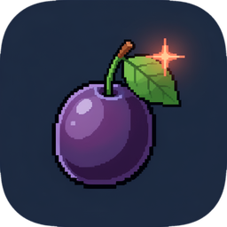
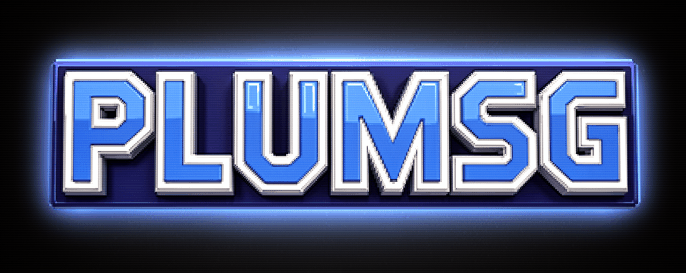
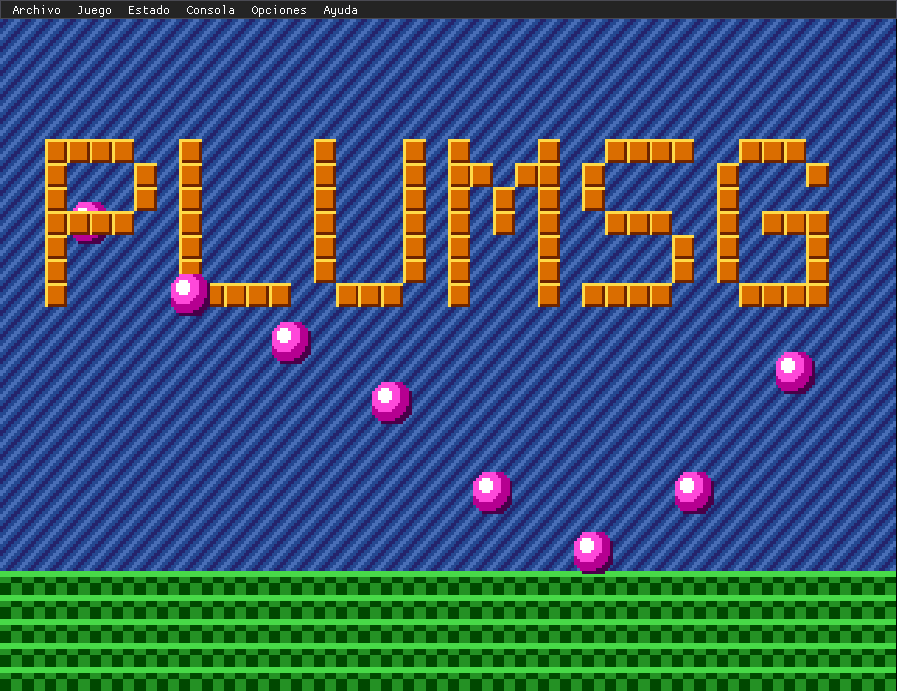
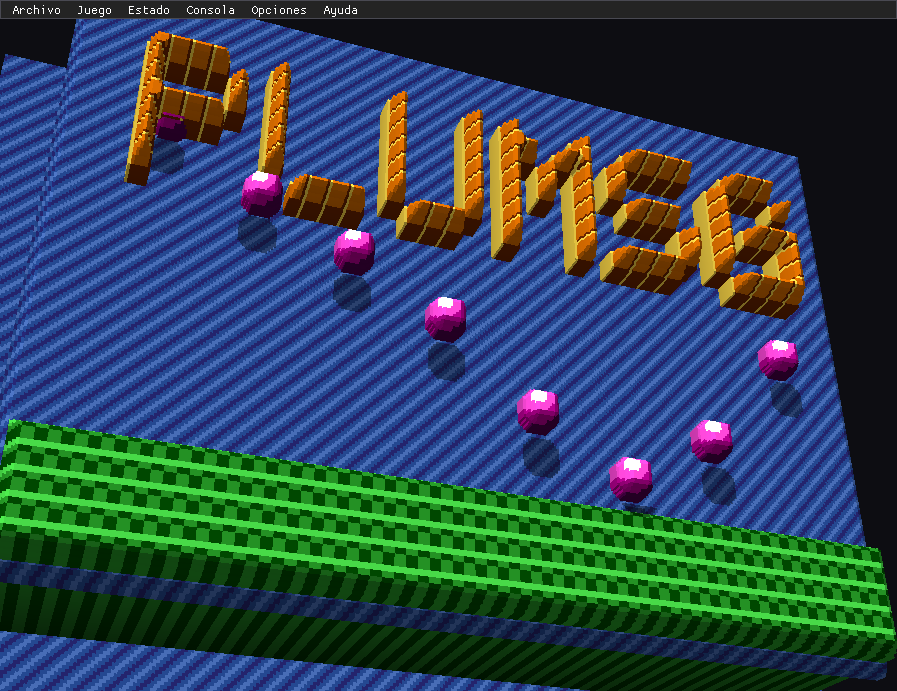

<p align="center"><br></p>

# plumsg

A **Sega Mega Drive / Genesis**, **32X** and **Mega CD / Sega CD** emulator for Windows (and
Linux) with a **pseudo-3D** effect that pulls the console's layers apart and puts them at
different depths, and with **save states**. It grew out of
[plumgg](https://github.com/cochimbo/plumgg), the Game Gear emulator, from which it inherits
the Z80, the PSG, the frontend and the 3D effect.

| 2D | Pseudo-3D (voxels) |
|---|---|
|  |  |

The screenshots are of the project's own test ROM, running on Linux with Mesa.

**Getting started**: the [quick start](docs/quick-start.md). Questions: the
[FAQ](docs/faq.md). Which games work: the [compatibility list](docs/compatibility.md).
What each version brings: the [changelog](CHANGELOG.md). Something fails:
[report it here](https://github.com/cochimbo/plumsg/issues/new/choose).

## Status

First version. What it has:

- **68000 CPU**, complete, with per-instruction timing: it passes 1,000,020 of Tom
  Harte's 1,000,060 single-step tests (the 40 that fail are rare *address error* cases).
- **VDP**: H32/H40 and V28/V30 (PAL) modes, planes A and B with full-screen, per-tile-row
  and per-line scrolling, per-column vertical scrolling, window, sprites (links, per-line
  limits, masking, collision), priorities, shadow/highlight, interlace, DMA (68000, fill
  and copy), line and frame interrupts, HV counter.
- **Z80** with its memory map, BUSREQ/RESET and the bank into 68000 space.
- **Sound**: YM2612 (with [ymfm](https://github.com/aaronsgiles/ymfm)) and PSG, mixed and
  resampled to the output.
- **Cartridges**: `.bin`, `.md`, `.gen`, `.smd` (interleaved) and inside a `.zip`; SRAM to a
  `.sav` next to the ROM; the serial (I2C) EEPROM that Acclaim games save to (NBA Jam, NBA
  Jam TE also on 32X, NFL Quarterback Club...) and some Sega and EA ones (Wonder Boy in
  Monster World, Mega Man: The Wily Wars, John Madden '93...), also to a `.sav`; the Super
  Street Fighter II mapper.
- **32X** (`.32x`, or a `.bin` with its header): both SH-2 CPUs with their modules
  (division, DMA, timers, the serial port between them), the 32X VDP (packed pixel,
  direct color and run-length modes, with its palette and its priority against the Mega
  Drive), PWM sound, the communication registers and the 68000's FIFO. No BIOS needed:
  plumsg does what the boot ROMs do. In 3D, the 32X picture sits flat at the back and the
  effect stays on the Mega Drive planes. The SH-2 cache counts for timing (reading from
  ROM what is already cached does not wait, as on the console), and an SH-2 that is only
  waiting for a register to change is not emulated instruction by instruction: its clock
  jumps ahead until something can change it.
- **Master System** (`.sms`, or a `.bin` with its `TMR SEGA` header), run the way the Mega
  Drive itself runs it: the console's Z80 and PSG with the Master System VDP (mode 4:
  background with per-line scrolling and scroll locks, tiles in front of sprites, the
  blanked left column, 64 8x8 or 8x16 sprites with zoom, line and frame interrupts, 192,
  224 and 240-line modes), the Sega mapper with cartridge RAM (to a `.sav`) and the pads:
  button 1 = A or B, button 2 = C, Start = Pause. Also the Codemasters mapper, the old
  TMS9918 modes (Graphics I and II, text, their sprites) and the FM unit (YM2413), which
  Japanese consoles have (Japan region) and, with **Console > Master System FM sound**,
  all of them. In 3D the background goes to plane B, its priority tiles to plane A and
  the sprites to their layer.
- **Game Gear** (`.gg`, or a `.bin` with the Game Gear header): the same machine with its
  160x144 screen (the middle of the picture, shown at 4:3), its 4096-color palette, the
  START button (the pad's Start) and stereo sound.
- **Mega CD** (`.cue` with its `.bin` or `.wav` files, `.iso`, `.chd`, or a single data
  track `.bin`): the second 68000 CPU at 12.5 MHz with its program RAM, the shared word
  RAM (2 and 1 Mbit modes, with the cell and dot views), backup RAM (to a `.sav` next to
  the disc), the CD controller (with DMA), the drive emulated at command level, the
  graphics chip that rotates and scales stamps, the timer, the RF5C164 PCM chip and CD
  audio, all mixed with the FM and the PSG. It needs the BIOS for the disc's region (see
  below).
- **Mega CD 32X** (Corpse Killer, Night Trap, Fahrenheit, Slam City, Supreme Warrior,
  Surgical Strike): discs whose header says `SEGA 32X` run with both add-ons, the 32X
  holding no cartridge. The Mega CD BIOS boots the disc as usual and the game starts the
  32X, whose boot ROMs (done by plumsg, as for cartridges) take the SH-2s' program from
  the frame buffer; the PWM, the PCM and CD audio are mixed together. Corpse Killer only
  reads pad 1 when nothing is in port 2 (or a Menacer is): set **Consola > Mando 2** to
  **Sin mando** in its game options.
- **Paprium**: the chip on its cartridge (graphics unpacking, sprites, the menus'
  scaling, saves and sound effects). Its music is recordings outside the ROM: put the
  album's tracks (`.ogg`, `.mp3` or `.wav`, each name starting with its number, such as
  `01 Theme of Paprium.ogg`) in a folder with the ROM's name next to it (`Paprium.bin`
  and `Paprium/`).
- **MSU-MD** (and **MSU-32X**): cartridges patched by the community to play their music
  from CD tracks, 32X ones too.
  Just put a `.cue` with the same name next to the cartridge (`Sonic.md` and `Sonic.cue`,
  with the tracks it names): the game starts with the Mega CD attached, as on a real
  console (mode 1). A Mega CD BIOS of any region works; with none the game runs on its
  own, without CD music, and plumsg says so. That `.cue` does not show up as a separate
  disc in the library, and the game saves to the cartridge.
- **Pads** with 3 and 6 buttons, two players, automatic or forced region.
- **Save states**: 10 slots per game with date and thumbnail.
- **Pseudo-3D**: five planes (sky, plane B, plane A, sprites and priority tiles), in
  layers or voxel style, with extrusion of plane A's solid tiles. Side lighting with soft
  shadows between planes, a live camera that sways following the action, and the camera
  tilt can be removed to look straight on.
- **Per-game 3D profiles**: each ROM can keep its own 3D settings.
- **Rewind, fast forward and slow motion**.
- **Run-ahead**: removes 1 or more frames of input lag, as in RetroArch.
- **No sprite limit**: every sprite on a line is shown, without the flicker the console's
  limit causes.
- **Widescreen** 16:9, 16:10 or custom, each side separately: you see what lies beyond
  the edges of the screen.
- **Overclock**: the console's processor runs faster, for games that slow down.
- **Image filters** for the 2D view: scanlines or full CRT.
- **Experimental upscaling** of the 2D view on the graphics card: xBR or the Anime4K
  neural network.
- **Cheats**: Game Genie and Action Replay, saved per game, with each game's cheat lists
  from libretro-database to pick from a menu.
- **Game library** with cover art, downloaded by itself from libretro-thumbnails, with
  several folders and a tab per console (Mega Drive, 32X and Mega CD).
- **Mega CD BIOS**: you say where each region's BIOS is (it does not come with plumsg),
  and each disc starts with its region's.
- Two-player **netplay** with GGPO-style *rollback*: each player on their own computer,
  over the internet or at home (see below).
- **RetroAchievements**: retroachievements.org achievements, challenges and leaderboards,
  with your account there and hardcore mode (see below).

There are no commercial ROMs in the repository or in CI: the tests use a ROM generated by
the project itself (`tests/test_rom.h`), its own 32X program (`tests/mars/`), its own Mega
CD program with a disc built in memory (`tests/megacd/`) and the free 240p Test Suite
(`tests/240p/`). Nor are the Mega CD BIOS files there.

## Usage

Drag a ROM or a disc onto the window, use **File > Open ROM...** or open the **library**
(F10).

| Key | Action |
|---|---|
| Arrows | D-pad |
| A, S, D | Buttons A, B, C |
| Q, W, E | Buttons X, Y, Z |
| Enter | Start |
| Right Shift | Mode |
| F3 | 3D effect |
| F5 / F8 | Save / load state in the current slot |
| F4 (gamepad: left stick click) | States menu |
| F10 or Ctrl+L | Game library |
| F6 / F7 | Previous / next slot |
| Backspace (gamepad: left trigger), hold | Rewind |
| Tab (gamepad: right trigger), hold | Fast forward |
| F9 | Slow motion (on / off) |
| F | FPS counter with its graph (on / off) |
| F1 | Reset |
| F12 | Stop emulation: closes the game and goes back to the start screen (or the library) |
| F2 | Change view (2D / debug layers) |
| P | Pause |
| M | Mute |
| F11 or Alt+Enter | Full screen |
| Esc | Show or hide the menu bar |

Everything can be changed in **Options > Controls**. The first gamepad connected is
player 1 and the second, player 2; player 2's keyboard is empty by default. Each game can
also have **its own buttons**: in **Game > Options for this game**, **Controls** tab, tick
*This game's own buttons* and assign the keys and gamepad buttons you want; while that
game is open they replace the general ones (shortcuts such as save state or rewind stay
the general ones). **Back to the general ones** removes them. They are saved in the game's
`.ini` in `profiles\`.

- **State**: save, load and choose a slot; hovering the mouse over a slot shows its
  thumbnail. The **States menu** (F4, or the gamepad's left stick click) pauses the game
  and shows the 10 slots with their thumbnails: up and down to choose, A (or Enter) to
  load, Y (or Space) to save and B (or Esc) to close. States are in
  `%APPDATA%\plumsg\plumsg\states\` (or in `states\` next to the executable if there is a
  `plumsg.ini` beside it, portable mode). A state from another ROM, or a damaged one, is
  rejected without touching the game. Loading a state also restores the SRAM in memory;
  the `.sav` is still written when quitting, changing ROM or stopping emulation.
- **Game > Stop emulation** (F12): closes the game without closing plumsg. It saves the
  cartridge save, leaves the netplay session if there is one and goes back to the start
  screen, or to the library if it has folders.
- **Game > Speed**: slow motion and how many seconds can be rewound (20 by default, up to
  60; 0 turns it off), how fast fast forward goes (4x) and slow motion (50 %). The sound
  follows: higher when speeding up and lower in slow motion. When rewinding the game goes
  backwards frame by frame, silently, and on release it carries on from there.
- **Game > Speed > FPS counter** (F, or in the Speed tab of the States menu): the game's
  frames per second against what it should be (60 or 50), the frames that reach the
  window, the milliseconds each frame takes to emulate (and what share of a frame's time
  that is) and those of the whole loop, with two graphs of the last 10 seconds (FPS and
  milliseconds, with the target as a dashed line). **Counter position** picks the corner.
- **Game > Latency > Run-ahead** (off by default, 1 to 4 frames): every frame the game runs
  that many frames ahead, without sound, shows that picture and goes back, so what you
  press shows up sooner. 1 is usually enough; each extra frame asks more of the computer.
  It can also be set per game in Options for this game.
- **Options > Video > No sprite limit** (off by default): the console draws at most 20
  sprites per line (16 in narrow mode) and 320 pixels of sprites, and games take turns
  over which ones are left out, which is why they flicker. With this option all of them
  are drawn. The console still tells the game it went over, just like the real one, so
  the game behaves the same: it does not affect netplay, run-ahead, achievements or
  states. The trick of hiding sprites with one at x = 0 is respected. If a game still
  flickers, it is hiding the sprites itself. It can also be set per game.
- **Options > Video > Widescreen** (off by default): buttons for 4:3, 16:10 and 16:9, and a
  slider per side (0 to 56 columns) that changes the picture live, always centered. On
  the sides you see what the game has in its planes and sprites beyond the edges. Since
  the game never expected that to be seen, some show enemies early, bits of the level not
  drawn yet or things hidden off screen; that is fixed by removing columns from that side
  (in Sonic, for example, the right one, because the level is drawn just before it comes
  into view). "Save the widescreen only for this game" keeps both sides for the open
  game, and it can also be set in Options for this game. The game does not notice: it
  does not affect netplay, run-ahead, achievements or states (the state thumbnail stays
  4:3). The headless build tests it with `--widescreen 16:9` or `--widescreen 53,16`
  (left, right).
- **Console**: region (automatic from the header, Japan, USA or Europe/PAL) and pad type
  (3 or 6 buttons) for each port. Changing the region resets the game.
- **Console > Overclock** (off by default): the 68000 runs at 150, 200, 300 or 400 % of its
  speed, so games that slow down when there is a lot on screen finish each frame on
  time. The rest of the console (Z80, VDP, sound, Mega CD and 32X) keeps its speed.
  Unlike the sprite limit, the game does run differently: some may go too fast or fail,
  and then it is turned off for that game (it can be set per game in Options for this
  game). It is stored in save states; in netplay the host's setting rules, and in
  RetroAchievements hardcore mode it stays off.
- **Options > Video**: scaling, 4:3 or square pixels, and the 3D options (style, depth,
  tilt, rotation, zoom, thickness, extrusion, shadows, plane B with priority in front,
  flat plane B for games that paint the sky on it). The 3D camera turns by dragging with
  the mouse or with the right stick, and is centered with a double click. Three
  checkboxes change how the depth shows: **Tilt the camera** (unticked, it looks straight
  on and the picture matches the 2D one), **Lighting** (side light on the blocks and soft
  shadows from each plane on those behind) and **Live camera** (a 3 to 4 degree sway that
  follows the sprites and the scrolling). **Save the 3D just for this game** creates a
  profile with all those settings (also the 3D effect and the camera) that comes back
  when that ROM is opened; it is in `profiles\` next to `states\`. Unticking it puts the
  game back on the general settings.

- **File > Library** (F10): the games in one or more folders and their subfolders, with
  their cover, in a grid you can drive with the mouse, the keyboard or a gamepad (D-pad to
  choose, A to play, B to close, Y to search). The first time it asks for the folder;
  **Add folder...** adds more and **Remove** takes them out. Each game's console comes
  from its extension: `.md`, `.gen`, `.smd` and `.bin` are Mega Drive (a `.bin` with a 32X
  or disc header is recognized too), `.32x` is 32X, `.sms` Master System, `.gg` Game Gear,
  and `.cue`, `.chd` and `.iso` Mega CD; the `.bin` tracks of a `.cue` do not show up on
  their own. The **All**, **Mega Drive**, **32X**, **Mega CD**, **Master System** and
  **Game Gear** tabs filter by console (with a gamepad, the L and R buttons; with the
  keyboard, Page Up and Page Down). **Download missing covers** looks them up by each
  game's name (No-Intro and Redump names, like `Sonic The Hedgehog (USA, Europe).md`,
  almost always match) in libretro-thumbnails, in each console's set, and saves them in
  `covers\` next to `states\` (32X ones in `covers\32X\` and Mega CD ones in
  `covers\MegaCD\`). Your own picture works too: a `.png` or `.jpg` with the game's
  name next to it, or in a `caratulas` or `covers` folder in the games folder. If one
  does not appear, or the wrong one does, **Find cover...** in the game's menu (right
  click, X on the gamepad or the menu key) lets you change the name searched for and
  lists the covers with similar names (part of the name, a typo or `2` for `II` will do);
  clicking one shows it, and **Use this cover** saves it as the game's. If folders are
  set, the library opens on start when there is no game. **Grid** and **List** switch the
  view (also Select on the gamepad or the V key): the list has title, console, year,
  genre, developer and players columns, and is sorted by clicking its header or with the
  sort drop-down, which works for both. With **Details** ticked, a panel on the right
  shows the chosen game: its cover, a play button, developer, publisher, genre, year and
  players (from libretro-database's metadat files, downloaded once per console; there are
  none for the Mega CD), a screenshot of the game (from libretro-thumbnails) and its
  Wikipedia description, in plumsg's language or, failing that, in English, with a link
  to the page. Everything is kept in `game-info\` next to `covers\`; **Search again**
  looks up the game's description and screenshot again.
- **ScreenScraper media...** in a game's menu (or in the details panel): what
  [ScreenScraper](https://www.screenscraper.fr) has of the game, found by its ROM's CRC32,
  name and size (a disc by its name), or by its title if that fails: front cover, whole
  sleeve, back cover, 3D box, cartridge label, cartridge, screenshot, title screen, logo,
  marquee, fan art and, if ticked in **What to download** (or one by one), the video and
  the manual. The window shows each file (hover to enlarge, click to open) and the game's
  data and description; **Search for another game** searches by name in any console when
  it found the wrong one, and **Use this game** downloads that one's instead. The files go
  to `game-info\screenscraper\<console>\<ROM name>\` with `ficha.json`, and the sleeve
  and the label also become the game's cover and the label of its 3D cartridge.
  **Download from ScreenScraper** in the library does every game not done yet, one at a
  time. ScreenScraper needs the program's developer account (built in, or typed in the
  **Account** tab) and, optionally, your free screenscraper.fr account for more requests
  a day; the password is kept in `plumsg.ini`, since ScreenScraper asks for it with every
  request.
- **Console > Mega CD BIOS** (or the library's button): the BIOS file for each region
  (Japan, USA and Europe, 128 KB, like `bios_CD_U.bin`). plumsg says whether the file looks
  like a BIOS and which region it is, and **Search the library's folders** finds them by
  itself. Each disc uses its region's BIOS.
- **Game > Cheats**: Game Genie codes (`ABCD-EFGH`, they change the ROM) and Action Replay
  (`FF0A12:0009`, or `FF0A12:09` for one byte; they set that RAM value every frame). Each
  is turned on or off with its checkbox and saved for that game in `cheats\`. A code can
  be several joined with `+` (`AJ0T-CA9Y+FFA3C5:0006`). On the Master System and Game Gear
  they are digits: Game Genie `3A8-6CF-E66` (the last three, optional, say which byte
  changes, and every ROM bank is searched) and Action Replay `00C0-1205`. **Cheats from
  the internet** shows those in the game's list in
  [libretro-database](https://github.com/libretro/libretro-database) (RetroArch's cheat
  database, almost 2,100 Mega Drive lists, plus 32X and Mega CD ones), downloaded when the
  window opens: the one with the ROM's name first, and other similarly named ones in
  **List** (Action Replay ones, other regions). They are filtered by name and **Add** puts
  the cheat in the game's list, turned on. If the game checks its ROM (Sonic stays red),
  its **Master Code** is added too.
- **Options > Video > 2D filter**: **Scanlines** (the dark lines between the TV's lines,
  thinner where the picture is bright) or **CRT** (also the slightly curved screen, the
  color mask and the dark corners), with their strength. They show more the bigger the
  window, best in full screen.
- **Options > Video > Upscaling (experimental)**: draws the 2D picture bigger than the
  console makes it, guessing the detail. **xBR** rounds off the stair-stepped edges of
  diagonals (a single pass, any graphics card will do). **Anime4K** is a small neural
  network that doubles the picture once, or twice from about 540 lines, and looks
  smoother. While it is on it replaces the 2D filter; the 3D view and recordings do not
  use it. It is also in the options tab of the States menu and in each game's own
  options.
- **Sound**: volume, mute and the music mode. **Original** is the chips' own sound.
  **Synthesizer** plays the FM and PSG music as General MIDI notes on a SoundFont, as it
  would sound on a module like the Roland SC-55; voices and sampled drums (the DAC) keep
  sounding as on the console. The **Original sound** control lets you hear the FM and PSG
  underneath too, and **Reverb** and **Chorus** add ambience. Each of the game's
  instruments gets a General MIDI instrument from some automatic rules, which can be
  changed by hand in the **Instrument editor**. The rules look at the sound (its envelope,
  how bright it is and the relation between its operators: basses, pianos, bells,
  marimbas, flutes, clarinets, brass, organs, strings, pads, guitars...) and at how the
  game plays it: after the first notes, a short sound that almost always repeats the same
  note goes to the drums (kick, snare, toms or hi-hat), the usual register says whether it
  is a bass, chords make it a pad and very short notes, pizzicato strings. With **Choose
  instruments by comparing the sound** (in the Sound menu, on by default), once an FM
  instrument has played 8 notes it is played quietly on a separate YM2612 next to each
  instrument of its General MIDI family in the SoundFont, their spectrum and envelope are
  compared and the closest one is used. This happens in the background and arrives a few
  frames later. All of this can be changed for one game only from its options. On the
  Master System and Game Gear too: the FM (YM2413) plays its 15 built-in instruments as
  the General MIDI ones they imitate (violin, guitar, piano...) and its drums with the
  SoundFont's, and the Game Gear's stereo puts each PSG channel on its side.

  plumsg comes with **GeneralUser GS** in `soundfonts\` next to the executable. The `.sf2`
  files left in `sound\soundfonts\` (**Open the SoundFonts folder** opens it) show up in
  the **SoundFont** drop-down to pick with one click, and **Choose another (.sf2)...**
  opens one from anywhere:
  - **SoundFont 2** format (`.sf2`). `.sf3` (compressed), `.sfz` and `.dls` do not work; an
    `.sf3` can be turned into an `.sf2` with Polyphone.
  - It has to be laid out as **General MIDI**: the 128 instruments in bank 0 and the drums
    in bank 128. GM, GS and XG SoundFonts are; a single-instrument one will sound the same
    on every channel, or silent.
  - It is loaded whole into memory and takes about twice its size: a 30 MB one is
    instant, a 500 MB one takes a few seconds and needs 1 GB free.
  - If the file cannot be read or is not a SoundFont, plumsg says so.

  Some that sound good: GeneralUser GS (the included one), FluidR3 GM and those that
  imitate the SC-55 or SC-88.
- **Sound > Instrument editor** (or **Instrument editor...** in a game's menu in the
  library): to choose what each instrument sounds like without having to play at the
  same time.
  - **Record from the game** records the music while you play, until **Stop recording**.
    The recording is saved in `sound\tracks\` (next to `states\`) as a `.vgz`.
  - **Get songs** looks for the songs in the game's ROM and records them one by one into
    `sound\tracks\<game>\`, numbered, without names (`Song 01.vgz`, `Song 02.vgz`...), each with one loop and
    its loop point so it keeps playing. It starts the game by itself and finds its sound
    driver (the code that drives the FM chip, or the Z80) and how the game asks it for
    music: a byte the game writes and the driver clears (Sega's SMPS and similar), a
    routine the game calls with the number in a register (like Streets of Rage 2) or on
    the stack (EA games, like NHL 96, which have two routines, each with its songs, and
    Ecco the Dolphin), or a ring of commands in Z80 memory where the game leaves messages
    (the GEMS of Sega of America games, like Sonic Spinball). Then it asks for each
    number in turn. Tested with Sonic 1, 2 and 3, Gunstar Heroes, Ristar, Shinobi III,
    Golden Axe, Streets of Rage 2, Sonic Spinball, Earthworm Jim, Taz in Escape from Mars,
    NHL 96, Ecco the Dolphin, Castle of Illusion, QuackShot, Streets of Rage 3, Beyond
    Oasis and Shadowrun (those three with the driver on the 68000, which passes the notes
    to the Z80). On the Master System and Game Gear, where the game and the driver share
    the Z80, it looks for the byte the game writes and the code that drives the PSG or the
    FM clears; the `.vgz` files have the PSG, the YM2413 and the Game Gear's stereo
    (tested so far with one of the project's own test games). Whatever plays on one or two
    channels, even for a long time (an engine, an alarm), counts as a sound effect and not
    a song. It takes a few minutes, with a progress bar, and can be stopped.
  - Along the way it learns which are the game's **sound effects** (rings, jumps,
    hits...): the FM instruments that play in the short sounds and in no song. With **Sound
    > Original sound effects** (the default) they sound as on the console and only the
    music goes through the SoundFont. They are saved in `sound\<game>.effects`.
  - **Mega CD** discs and **MSU-MD** games always sound original: their music is CD audio
    tracks, and the FM and PSG only play effects.
  - The ROM does not have its songs' names (each game keeps its music its own way), but
    [vgmrips](https://vgmrips.net) has almost all of them: its `.zip` for a game, or its
    `.vgm` and `.vgz` files, are opened with **Open .vgm...** and saved in
    `sound\tracks\<game>\` (**Folder** opens it). From then on, that game's **Track** list
    has each song by its name, like "Green Hill Zone", next to the recordings. The game's
    own sound test works too: start recording and play its songs.
  - **Play** plays it with the game paused. **Original** and **Synthesizer** switch between
    the two sounds at the same point, to compare, and the **SoundFont** list below (the
    same as in **Sound**) changes SoundFont without leaving the editor. **Equalizer...**
    raises or lowers the synthesizer's bass, mids and treble (-12 to 12 dB), here and in
    games. Each channel (FM 1-6, DAC, PSG 1-3 and noise) has **Solo** and **Mute**.
  - The table shows the track's instruments (FM A, FM B...: letters so as not to confuse
    them with FM channels 1-6), what they sound like, their channels and their notes, in
    rows level with the channels'; the chosen instrument's channels are highlighted. Those
    playing at that moment are green. Each can be given a General MIDI **Instrument**
    (with octave and volume), a GM **Drums** piece, or keep its **Original sound**. **Hear
    only this one** silences everything else, **Back to the suggestion** undoes what was
    chosen for that instrument and **All back to suggestions...** for every one in the
    game.
  - An FM instrument is recognized by its registers, without its volume or release rate:
    drivers like Sonic's set the release to the maximum to cut a note or make room for an
    effect, and before 0.0.23 that made it pass for another, unassigned instrument. What
    was saved with the old fingerprints still works.
  - What you choose is heard straight away, in the game too, and saved in
    `sound\<game>.ini`, for that game only. With the editor open without a game it goes
    to `sound\cache.ini`, which applies to all of them (versions up to 0.0.22 saved each
    game's settings there too, and they still play); a game's own settings override the
    shared ones.
- In full screen, **Open ROM...** uses plumsg's own file browser (gamepad-friendly too)
  instead of the Windows dialog, which used to hide behind the game.

The settings are saved in `plumsg.ini`.

### Recording video or GIF

In **Game > Record**:

- **Record video** (`Ctrl+R`) records the game with its sound to an `.avi` (Motion JPEG and
  PCM), which Windows, VLC and video editors open without installing anything. It goes
  past 1 GB without trouble.
- **Record GIF** (`Ctrl+G`) records an animated GIF without sound, at 30 frames per
  second, to share a bit of a game.

It stops with the same shortcut (or from the menu); the time recorded shows at the top
center. The files go to the `recordings` folder (next to `states`), named after the game
and the date; **Open the recordings folder** opens it. In the 2D view the console's
picture is recorded as is, sharp and without the filter (the video at 960x672); in 3D,
what is on screen, without the menus (the video up to 720 lines and the GIF around
480x360). Menus, pause or rewinding end up in the recording as on screen; if the game
stops or another game is opened, the recording is closed.

### Netplay

**Network > Netplay...** menu. Both players open the same game (the same ROM) first.

- The **host** (player 1) clicks *Host*. While waiting they can keep playing: the netplay
  game starts from where they are, with their cartridge save, their region and their
  pads.
- The one who **joins** (player 2) types the host's address (`IP` or `IP:port`) and clicks
  *Join*. They receive the host's game in a moment and both start at once.
- Each player uses **their player 1 controls** (keyboard or gamepad).
- At home, the address the window shows is enough. Over the internet, the host forwards
  **UDP port 7845** (it can be changed in the window) on their router to their computer
  and gives the other player their public IP; or both use a private network like
  Tailscale or ZeroTier and nothing needs opening. The first time, Windows asks whether
  plumsg may use the network: allow it.

How it works: each console runs the game on its own and only the buttons are sent. What
the other player presses is guessed (they keep doing what they last did) until it
arrives; if the guess was wrong, plumsg goes back a few frames with a save state and
replays them with the right input, with no more than a small jump. So nobody waits for
the network as long as the ping stays under about 150 ms. The **input delay** (2 frames by
default) reduces those jumps in exchange for a little delay when pressing. Every second
both consoles compare their memory; if they ever stopped matching, the window says so.

During netplay you cannot pause, rewind, change the speed, load states, reset, change the
region or use cheats (they would make the two consoles stop seeing the same thing). Saving
states is fine. The joining player's cartridge save is not touched: the host's is used.

### Achievements (RetroAchievements)

**Achievements** menu. Turn on *RetroAchievements* and log in under **Achievements >
Account...** with your [retroachievements.org](https://retroachievements.org) account (it
is free). The password is not saved: plumsg saves in `plumsg.ini` the session the server
gives it, and next time it logs in by itself.

- When a game is opened it is looked up in RetroAchievements by its hash (the same one
  RetroArch and other emulators use; for the Mega CD, the disc header's). If it is known,
  a notice says how many of that game's achievements you have.
- Each achievement you earn shows in the bottom right corner with its badge, also in full
  screen and with the menu bar hidden. The top left shows the running challenges, the
  progress of an achievement being earned and the leaderboard counters.
- **Achievements > This game's achievements...** lists them all, earned or not, with
  their progress.
- **Hardcore mode**: achievements count for the hardcore score and the leaderboards, but
  you cannot rewind, use slow motion or cheats, or load states (saving them is fine).
  Turning it on with a game open restarts the game.
- Offline, achievements are kept and sent when the connection comes back.
- Each save state has next to it (`.achievements`) how the achievements stood at that moment.

### From the command line (LaunchBox, Playnite, arcade cabinets)

```
plumsg.exe "C:\Games\Sonic.md" --fullscreen --3d
plumsg.exe "C:\Games\Sonic CD.cue" --region eu --load-state 1
```

| Option | What it does |
|---|---|
| `game` | the cartridge or disc to open |
| `--fullscreen` / `--windowed` | full screen or windowed (up to 0.0.31 they were Spanish, e.g. `--pantalla-completa`; those still work) |
| `--console-mode` / `--desktop-mode` | console mode on or off for this time (see below) |
| `--3d` / `--2d` | with or without the pseudo-3D view |
| `--filter f` | `none`, `scanlines` or `crt` |
| `--upscaling u` | `none`, `xbr` or `anime4k` (experimental) |
| `--region r` | `auto`, `jp`, `us` or `eu` |
| `--load-state N` | loads the game's save state N (0-9) when it opens |
| `--library folder` | opens the library of that folder |
| `--list` | with `--library`: shows it as a list instead of a grid |
| `--record f.avi` | records the game from the start, as video (`.avi`) or GIF (`.gif`) |
| `--host` | hosts a netplay game with the game (on the Network menu's port) |
| `--join address` | joins that host's netplay game (`IP` or `IP:port`) |
| `--help` | shows the options |

The full screen and region given this way are for that time only: `plumsg.ini` stays as it
was. In LaunchBox, for example, add plumsg as an emulator with the path to `plumsg.exe`
and `--fullscreen` in the command-line parameters.

### Steam Deck, ROG Ally, Legion Go and other PCs played with a pad

**Console mode** is for playing from the sofa or on a handheld, with a pad and no
keyboard or mouse. It turns on by itself when Steam's game mode or Big Picture starts
plumsg (also as a non-Steam game under Proton) and on the handhelds that run Windows,
recognised by their model: ROG Ally and ROG Xbox Ally, MSI Claw, Legion Go and Go S,
AYANEO, OneXPlayer, GPD Win, Zotac Zone. It is switched in **Options > Console mode**
(Automatic, On, Off), in the states menu's Sistema tab or with `--console-mode` /
`--desktop-mode`.

In console mode plumsg:

- starts in full screen, without the menu bar and with the library (which asks for a
  folder of games if it has none);
- makes the letters and the windows bigger after the screen's height (125 % on the Steam
  Deck's 1280x800, 175 % at 1080p). **Options > Interface size** sets it by hand, in
  console mode or not, from 75 % to 250 %;
- lets the pad drive every window: the d-pad moves, A presses, B goes back, X jumps to
  the window's menu bar and holding X switches windows. While the pad is on a window the
  game waits; B with nothing left to close gives the pad back to the game;
- shows its own on-screen keyboard while a text box is being typed in without a
  keyboard (the library's search with Y, a host's address, a cheat code...): the d-pad
  chooses a key, A types it, B rubs out, Y is a space, X capitals, L1 / R1 move the
  cursor and Start accepts. It works on Windows handhelds too, where Steam's keyboard
  is not there; a real keyboard's key hides it;
- the states menu (left stick click) gains, in its Sistema tab, the library, Open ROM,
  Controls, Cheats, the game's own options, the whole menu bar (with the pad on it) and
  Quit plumsg, so that nothing needs a keyboard.

### If plumsg closes suddenly

If plumsg closes because of a crash, it leaves a report in the `crash-reports` folder of the
settings folder (`%APPDATA%\plumsg\plumsg\crash-reports`, or next to the executable in portable
mode): a `.txt` with what happened, where and with which game, and on Windows a `.dmp`
dump with the same name to open in a debugger. The next time it opens, plumsg says where
it is. To report the crash, attach both files.

### Language

plumsg is in English, Spanish, French and Portuguese. The first time it uses the system's
language (or English if it is none of those), and it is changed in **Options > Language**.
How to add texts or languages: [src/frontend/lang/README.md](src/frontend/lang/README.md).

## Building

You need CMake 3.16+, a C++17 compiler and SDL2 (if it is not installed, CMake downloads
it). Dear ImGui, ymfm and libchdr are downloaded by themselves.

```sh
cmake -S . -B build -DCMAKE_BUILD_TYPE=Release
cmake --build build --parallel
ctest --test-dir build --output-on-failure
```

On Windows, the `windows-installer.yml` workflow builds the installer with Inno Setup (see
[installer/README.md](installer/README.md)).

## Tests

- `core_tests`: cartridge, pads, PSG, VDP, the test ROM (picture and sound), save states
  (determinism, round trip, damaged files), rewind (going back and replaying gives the
  same frames), the pace of fast forward and slow motion, the 3D's plane separation (with
  the camera straight, the 3D has to look the same as the 2D), the live camera, 3D
  profiles, cheat codes (Game Genie decoded as Genesis Plus GX does), library names and
  how each game's console is recognized, the tracks of a `.cue` and the Mega CD BIOS. For
  the 32X: SH-2 instructions and modules, booting without a BIOS, drawing over the Mega
  Drive picture and states, and a C program (`tests/mars/program.c`) that both SH-2s run
  and that has to give exactly the same as the PC (libgcc division, 64-bit and floating
  point arithmetic...), plus interrupts, palette and PWM sound. It is rebuilt with
  `tests/mars/build.sh` (needs `gcc-sh-elf`); the result is in the repository. For the
  Mega CD: `.cue` sheets (several files, `INDEX 00`, `PREGAP`), a `.chd` made with chdman
  (`tests/megacd/disco.chd`), and an assembly program for both CPUs (`tests/megacd/main.s`
  acts as the BIOS and loads `sub.s` on the second CPU) that tests the communication
  between them, interrupts, backup RAM, drive commands, reading a sector through the
  controller and through DMA, the graphics chip, PCM, CD audio and states; the same
  program as a cartridge tests MSU-MD games' mode 1 (the Mega CD at 0x400000) and how
  their `.cue` is found. It is rebuilt with `tests/megacd/build.sh` (needs
  `binutils-m68k-linux-gnu`). For netplay: two sessions connected by a simulated network
  that delays, reorders, duplicates and loses packets have to see the same frames as
  each other and as a single console with both pads, even if they go back many times.
- `headless`: `plumsg-headless` end to end (hashes, input scripts, checks), and the save
  states from earlier versions in `tests/states/`.
- `240p`: Artemio Urbina's 240p Test Suite (`tests/240p/`): 35 scripts go through its
  menus to its test patterns and video tests, and each screen has to look as it did.
- `frontend_tests` (only with the interface, needs SDL2): each game's own options and
  buttons, read and written in its `profiles\` file, and the crash reports.
- `m68k_json_runner --cycles files.json.gz`: the 68000 single-step tests
  ([SingleStepTests/680x0](https://github.com/SingleStepTests/680x0)).
- `rom_runner rom.md --frames 300 --png shot.png`: runs a ROM without a window and saves
  the picture (with `--layers prefix` also each VDP layer, and `--wav` the sound). With a
  Mega CD disc, `--bios file` says which BIOS to use. `rom_runner --write-test-rom
  test.md` writes the test ROM to a file.
- `zex_runner zexdoc.com`: the Z80 exerciser.
- The emulator also takes screenshots from the command line:
  `plumsg rom.md --3d --tilt 30 --frames 120 --screenshot 3d.png`, with
  `--filter crt` or `--filter scanlines`, or of the library with
  `plumsg --library folder --download-covers --screenshot library.png`
  (`--library` can be repeated, `--bios` opens the BIOS window and
  `--find-cover` the cover search for the library's first game, `--media` its
  ScreenScraper media window, downloading them (`--media search` searching for its
  title, `--media all` downloading every game's);
  `plumsg rom.md --cheats --screenshot cheats.png` opens the game's cheats with its list and
  `--game-options` its own options, or `--game-options controls` its buttons).

## Without a window: `plumsg-headless`

`plumsg-headless` is the emulator without a window, sound output or graphics card, for
tests, CI and reproducing bugs. It runs a cartridge or disc for N frames, presses the
buttons a script says and saves whatever is asked: PNG screenshots, the sound as WAV, the
game as GIF or video (`--gif`, `--avi`), a hash per frame, states and RAM dumps. It also
checks results and says on which frame a run starts to differ.

To build just this (without SDL2, ImGui or OpenGL):

```
cmake -S . -B build -DCMAKE_BUILD_TYPE=Release -DPLUMSG_BUILD_FRONTEND=OFF
cmake --build build --target plumsg-headless
```

Examples (`plumsg-headless --help` gives every option):

```
# 600 frames and a screenshot of the last one
plumsg-headless game.md --frames 600 --png last.png

# a Mega CD disc with the BIOS files in a folder, a screenshot every 60 frames
plumsg-headless disc.cue --bios-dir bios/ --frames 1800 --png-every 60 --out-dir shots

# with an input script, saving the hash of every frame
plumsg-headless game.md --input play.txt --hash-log hashes.txt

# after a change in the core: on which frame does it stop looking the same?
plumsg-headless game.md --input play.txt --expect-log hashes.txt
```

The script has one command per line: the frames (`N`, `N-M` or `N+K`, counted from 0) and
the buttons held during them (`up down left right a b c x y z start mode`, and `p2.start`
etc. for the second pad), or a command: `screenshot [file]`, `savestate file`, `loadstate
file`, `dump-ram file`, `hash`, `reset`, `power` or `quit`. `--do "120+4 start"` gives a
line on the command line.

```
120+4    start          # press Start on the title screen
300-420  right
330+10   right c        # jump while walking
420      screenshot level.png
600      quit
```

Exit code: 0 fine, 1 something could not be read or written, 2 badly written options or
script, 3 a check failed (`--expect-hash`, `--expect-audio`, `--expect-log`). With `--json
file` (or `-` for standard output) the summary comes out as JSON. It has three built-in
ROMs: `--test-rom` (the one the tests use), `--pad-test-rom`, which paints the background
according to pad 1's buttons, and `--two-pad-test-rom`, in which every frame depends on
everything both pads pressed before (for testing netplay).

It also plays netplay like the window does, to test it: `--netplay-host PORT` hosts and
`--netplay-join IP:PORT` joins, each with its own script (the host uses pad 1's buttons
and the guest the `p2.` ones). `--net-lag MS` and `--net-loss PERCENT` simulate a slow
connection or one that loses packets. Each side's `--hash-log` has to match that of a run
without netplay with both scripts together:

```
plumsg-headless game.md --frames 3000 --netplay-host 7845 --net-lag 60 --input p1.txt --hash-log net1.txt &
plumsg-headless game.md --frames 3000 --netplay-join 127.0.0.1 --net-lag 60 --input p2.txt --hash-log net2.txt
cat p1.txt p2.txt > both.txt
plumsg-headless game.md --frames 3000 --input both.txt --expect-log net1.txt
```

The `ctest` tests use it (`tests/headless_tests.cmake`, `tests/240p_tests.cmake`) and the
`headless` CI job builds it without SDL2 and keeps its screenshots, sound and hashes as an
artifact.

## Licenses

Own code under the [MIT License](LICENSE). Libraries: SDL2 (zlib), Dear ImGui (MIT), miniz
(MIT, in `third_party/miniz`), stb_image and stb_image_write (public domain or MIT, in
`third_party/stb`), ymfm (BSD-3-Clause), the Anime4K network weights (MIT, by bloc97, in
`src/render/anime4k_shaders.h`, generated with `tools/anime4k.py`), the xBR shader written
following Hyllian's xbr-lv2 (MIT), libchdr (BSD-3-Clause, for `.chd` files), TinySoundFont
(MIT, in `third_party/tsf`), cgltf (MIT, in `third_party/cgltf`), rcheevos (MIT, for RetroAchievements), minimp3 (CC0, in
`third_party/minimp3`) and stb_vorbis (public domain or MIT, in `third_party/stb`). The
interface's typeface is Chakra Petch (SIL Open Font License 1.1, in
`src/frontend/assets/fonts` with its license). The included
SoundFont is GeneralUser GS by S. Christian Collins, with its own free license
(`soundfonts\GeneralUser-GS-LICENSE.txt` in the installation). The 3D library's Mega
Drive is ["Sega Mega Drive"](https://sketchfab.com/3d-models/sega-mega-drive-47cf3eae9fc3423db22aba119a6a37d5)
by synthetic worlds (mesh and textures by Jon Blenky), under
[CC BY 4.0](https://creativecommons.org/licenses/by/4.0/), with smaller textures
(`assets/models/CREDITS.txt`), and its cartridge
["Sonic 2 Mega Drive Cartridge"](https://sketchfab.com/3d-models/sonic-2-mega-drive-cartridge-4c453f8527384c718f652a9f04067119)
by Naser, also CC BY 4.0; the Master System, its pads and cartridge are
["Sega Master System"](https://sketchfab.com/3d-models/sega-master-system-0ec998c9b9de4e7f956cab56bbca3c0f)
by dark_igorek, CC BY 4.0. The 32X and Mega CD were
written using Sega's documentation and [ares](https://github.com/ares-emulator/ares)
(ISC) code as a reference. The 240p Test Suite in `tests/240p/` is GPL v2 and its SGDK
library LGPL v3, with their source next to it. Cover art and screenshots come from
libretro-thumbnails, the cheat lists and game details from libretro-database and the
descriptions from Wikipedia (CC BY-SA 4.0); they are downloaded when used and are not in
the repository.
